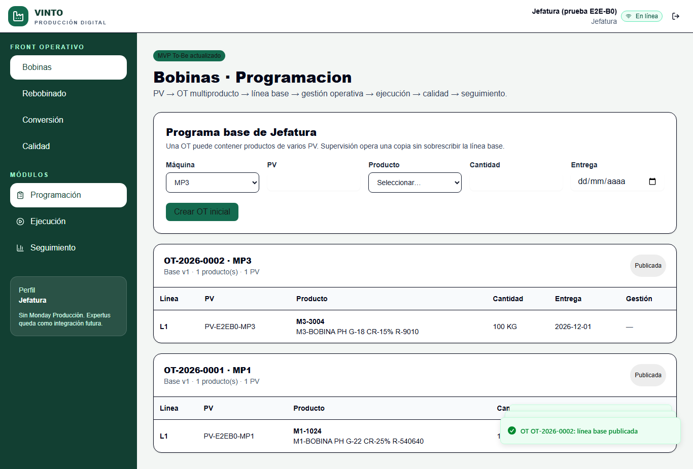
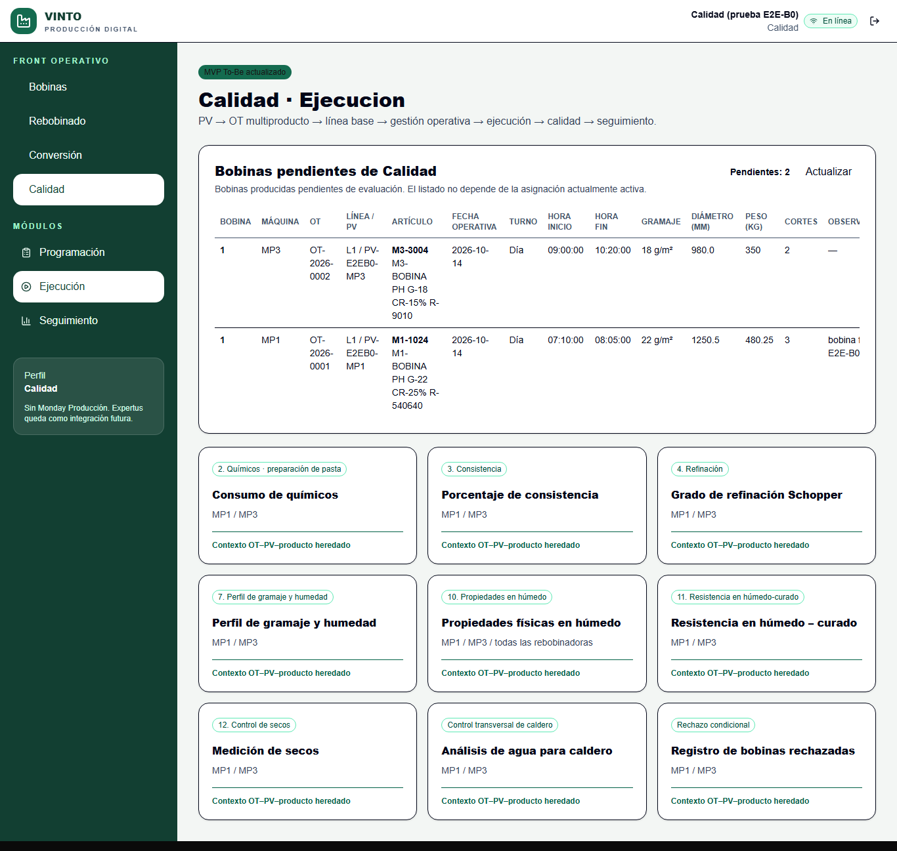
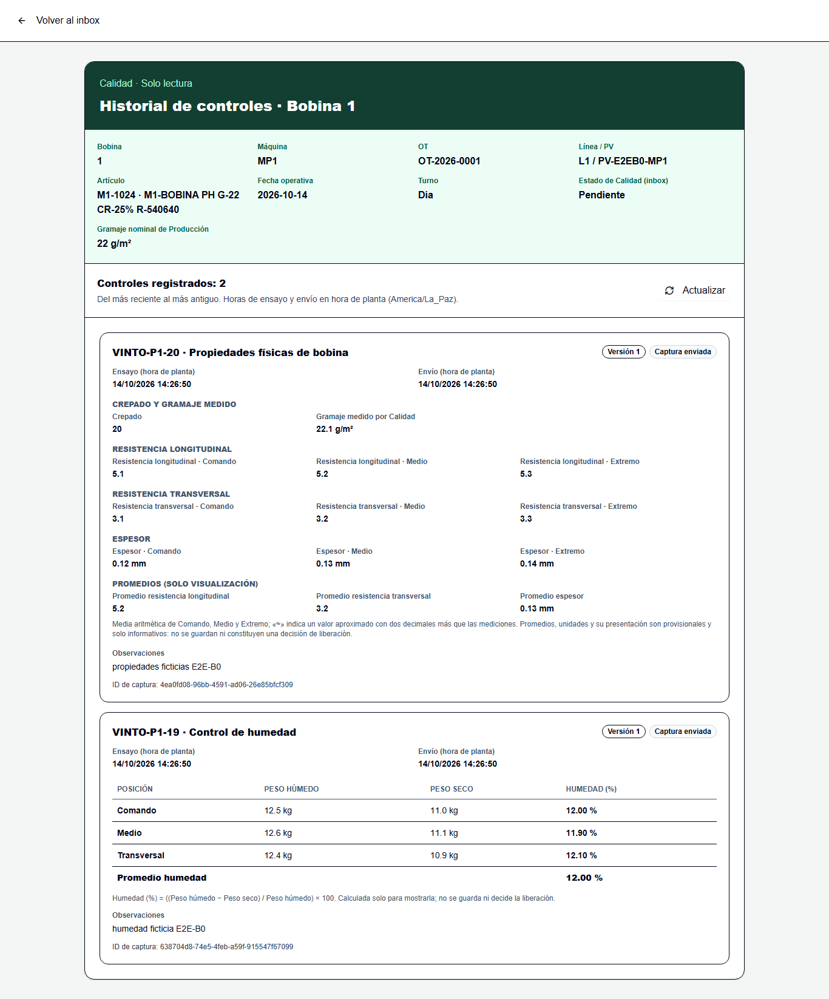
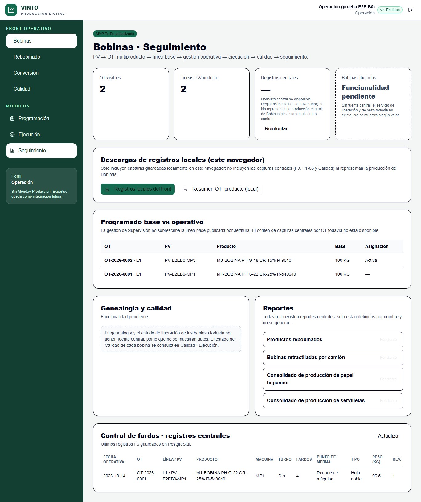
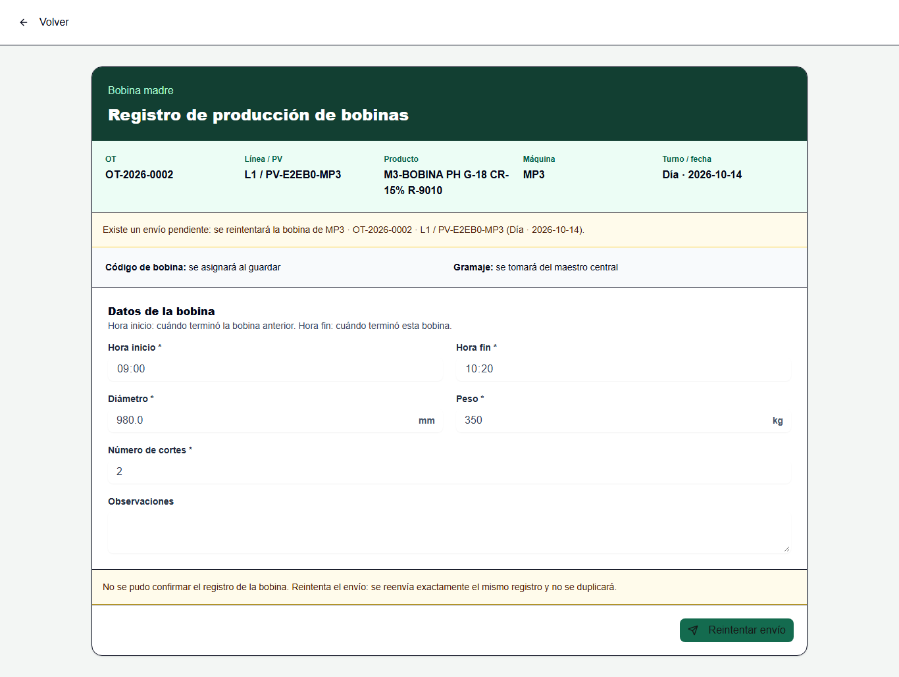

# E2E-B0 · Evidencias de la validación integral de Bobinas MP1/MP3 y Calidad

**Estado: prueba técnica. No homologa ninguna regla industrial ni autoriza el piloto.** Demuestra que el circuito técnico existente de Bobinas MP1/MP3 funciona de punta a punta (OT, asignación, captura F3 y P1-06, bandeja de Calidad, P1-19, P1-20 e historial) sobre la **aplicación real en `/`**, el **backend FastAPI real** y un **PostgreSQL efímero y exclusivo**. Los maestros usados son **candidatos** (no homologados), los usuarios y los datos son **ficticios**, las 52 decisiones `BO:` siguen **Pendiente** y Q-LIB y el piloto siguen **NO GO**.

## 1. Resultado
**Corrida `20261014T182540Z-a6d9c19a`: 109 comprobaciones, 109 PASS, 0 FAIL, 0 SKIP, 0 BLOCKED, limpieza verificada** (las 106 comprobaciones de la versión anterior del arnés siguen presentes y en PASS; se añadieron 3 de identidad: S0a, S0c y S0d, y S0b pasó a ser la identidad de los servicios) (59 de navegador, 26 HTTP complementarias, 22 SQL de solo lectura, 2 estática). Los casos E01 a E11 pedidos se ejecutaron todos; ninguno quedó omitido ni bloqueado. La columna «Tipo» distingue navegador, HTTP y SQL.

## 2. Código probado y entorno
| Elemento | Valor |
|---|---|
| Código de producto bajo prueba | idéntico al de `main` `911b7cb` (PR #37, PB-CLEAN): esta rama **no modifica** `app/`, `components/`, `lib/`, `backend/app`, migraciones, `seed_data`, permisos ni sectores |
| SHA probado de la corrida | `ae0d84c943ad86b8b1b61c8e9bc9422e9a9ee67b` (rama del PR #38, árbol limpio: `dirty = false`), fijado por el orquestador y comprobado por el recorrido contra `git rev-parse HEAD` |
| Identificador de corrida | `20261014T182540Z-a6d9c19a` (directorio de evidencias propio; ver §4) |
| Base efímera | `vinto_e2eb0_4f14b242d411_test` (nombre generado por ejecución, sin credenciales) |
| PostgreSQL | 17.11 (Debian 17.11-1.pgdg13+2), contenedor nuevo `vinto-e2eb0-pg`, datos en tmpfs, `127.0.0.1:55432` |
| Backend | FastAPI real (`app.main:app`), Python 3.12.10, `http://127.0.0.1:8190`, configuración real del producto |
| Frontend | Build de la aplicación con `NEXT_PUBLIC_API_URL=http://127.0.0.1:8190`, servido en `http://127.0.0.1:8796`; sin ruta ni harness de QA |
| Navegador | Chrome 155.0.8059.40 (CDP, headless), perfiles temporales; Node v24.20.0 |

## 3. Aislamiento verificado
- La base se identifica con `SELECT current_database()` dentro del PostgreSQL exclusivo de la prueba, debe terminar en `_test` y no puede ser `vinto`, `vinto_test` ni `postgres` (S0; también lo exige el servidor y `connect_test_database()`).
- API y frontend solo en `127.0.0.1`, puertos 8190 y 8796; la prueba aborta si usan 8000, 8787 o 5432 y si el navegador llama al puerto 8000. Todas las solicitudes del navegador de la ejecución final fueron únicamente a `127.0.0.1:8190` y `127.0.0.1:8796`, sin ninguna a DEV, PROD ni hosts externos (Z3).
- El PostgreSQL de la prueba **no es** el de desarrollo (5432): contenedor nuevo con nombre exclusivo y sin volumen; el orquestador se niega a ejecutarse si el contenedor o algún puerto ya existen o están ocupados y **no toca** el contenedor ni el volumen `vinto-local-*`.
- La configuración real se conserva y se verifica antes de servir: `DEFAULT_OPERATIONAL_SECTORS = (SECTOR_BOBINAS,)` y `CENTRAL_FORM_CODES = frozenset({FORM_CODE})` con `FORM_CODE = "VINTO-P1-06"`; el servidor de prueba no los reasigna (Z5 y `scripts/e2e-b0-guard.test.mjs`). F3 y Calidad usan sus rutas existentes (`/api/bobbins`, `/api/quality/...`).
- Usuarios ficticios creados solo en la base efímera; contraseñas aleatorias en un archivo temporal fuera del repositorio que se borra al terminar. Estas evidencias no contienen cookies, contraseñas ni tokens.

## 3b. Garantías del arnés (correcciones de la auditoría del PR #38)
- **Destinos fijos (H1).** API `127.0.0.1:8190`, frontend `127.0.0.1:8796`, contenedor `vinto-e2eb0-pg` y Chrome de ruta fija están en el código; el recorrido **rechaza** las variables heredadas `E2E_API`, `E2E_WEB`, `E2E_PG_CONTAINER` y `E2E_CHROME` (y el orquestador también) y solo recibe el resto por un manifiesto de la corrida. Antes de cualquier operación de negocio demuestra la identidad: el contenedor lleva la etiqueta de la corrida y publica solo `127.0.0.1:55432`; `current_database()` coincide con el manifiesto; los puertos 8190 y 8796 pertenecen a los procesos que lanzó el orquestador (backend y frontend); y el usuario que devuelve el login de la API existe en esa base. Pruebas negativas con un servidor señuelo (`scripts/e2e-b0-guard.test.mjs`) demuestran que ninguna petición llega a otro destino cuando se intenta redirigir.
- **Chrome CDP propio (H2).** Cada caso lanza su Chrome con `--remote-debugging-port=0` y un perfil temporal único; el puerto sale del `DevToolsActivePort` de ese perfil y se valida que el depurador anuncia ese identificador de navegador y que el puerto pertenece al árbol de procesos del Chrome lanzado. No hay puertos fijos ni se adjunta a sesiones ajenas; solo se cierra el PID propio. La prueba de colisión usa señuelos CDP en el rango antiguo y un Chrome ajeno abierto, y comprueba que el ajeno conserva exactamente sus pestañas y sigue vivo.
- **Limpieza como parte del resultado (H3).** Tras detener los procesos y eliminar el contenedor, el orquestador verifica que no quede contenedor (por nombre o etiqueta de la corrida), procesos cuya línea de comandos contenga el identificador de la corrida, puertos reservados ocupados ni directorios temporales propios. Si algo propio queda pendiente, el código de salida es 3 y el recurso se registra en `corrida.json`; nunca se elimina nada ajeno.
- **Resultados por corrida (H4).** Cada corrida escribe en su propio subdirectorio `<evidencias>/<runId>/` (se rechaza si existe o contiene resultados anteriores, sin tocarlos) y `resultados-e2e-b0.json` se crea sin sobrescribir y lleva `runId`, SHA, estado del árbol, conteos y fechas. El orquestador solo da la corrida por exitosa si el recorrido terminó bien, los resultados corresponden a su `runId`, SHA y base con conteos coherentes y sin fallos, y la limpieza está verificada; el veredicto queda en `corrida.json` (`status`: `passed` o `failed`).

## 4. Cómo reproducirlo
```
node scripts/e2e/b0-run.mjs <directorio-base-de-evidencias>
```
Cada corrida crea `<directorio-base-de-evidencias>/<runId>/` con `corrida.json` (veredicto, resultados y limpieza), `resultados-e2e-b0.json`, `entorno-e2e-b0.json` y las capturas. Una corrida solo es válida si `corrida.json` indica `"status": "passed"`.
Requiere Docker, Chrome y `backend/.venv` con `backend/requirements.txt`. El orquestador levanta el PostgreSQL exclusivo, el backend de prueba (`backend/tests/e2e_b0_server.py`), construye y sirve el frontend, ejecuta `scripts/e2e/b0-e2e.mjs` y, también si falla, detiene los procesos y elimina el contenedor (con todas las bases efímeras). Duración aproximada: 2 minutos. `node --test scripts/e2e-b0-guard.test.mjs` comprueba el aislamiento y las garantías H1 a H4 (estáticas y negativas, con señuelos; la de Chrome requiere Chrome instalado) sin Docker. Nota: el orquestador reconstruye `dist/` con la URL de la API de prueba; para volver a la configuración normal hay que reconstruir con `node scripts/run-framework.mjs build`.

## 5. Infraestructura reutilizada
Patrón de Chrome con CDP, `browser()`, `loginApp`, `logoutApp`, `client()` y las salvaguardas de `scripts/e2e/m4a-e2e.mjs` (copiados, con un registro de POST ampliado a las rutas de Bobinas y Calidad); la base efímera con plantilla migrada y bundle de `backend/app/ephemeral_db.py`, `backend/app/db_guard.py` y el patrón de `backend/tests/e2e_p110_server.py`. No se creó un framework nuevo ni se instalaron fixtures de otros sectores.

## 6. Resultados por caso
### Preparación y aislamiento (S) (6/6)

| ID | Tipo | Resultado | Comprobación | Dato observado |
|---|---|---|---|---|
| S0 | sql | PASS | la base del recorrido es efímera (*_test) y su identidad se verificó con current_database() dentro del PostgreSQL exclusivo de E2E-B0 | vinto_e2eb0_4f14b242d411_test |
| S0a | static | PASS | la corrida está identificada: el contenedor de PostgreSQL lleva la etiqueta de esta corrida, publica solo 127.0.0.1:55432 y el directorio de evidencias es el de la corrida | 20261014T182540Z-a6d9c19a |
| S0b | http | PASS | identidad de los servicios: el puerto 8190 pertenece al backend y el 8796 al frontend lanzados por esta corrida (no a otro servicio local) | backend pid 14788, frontend pid 35056 |
| S0c | http | PASS | la API real responde y su health consulta la base (200) | 200 |
| S0d | sql | PASS | la API sirve EXACTAMENTE la base de esta corrida: el usuario ficticio que devuelve el login existe en esa base (y solo en ella) | 200 |
| S1 | http | PASS | la API real responde con sesión y no hay OT ni capturas previas en la base efímera |  |

### E01 · Jefatura: OT (11/11)

| ID | Tipo | Resultado | Comprobación | Dato observado |
|---|---|---|---|---|
| E01.0 | browser | PASS | Jefatura entra por el login real y ve Bobinas · Programación | VINTO  PRODUCCIÓN DIGITAL  Jefatura (prueba E2E-B0) Jefatura En línea  FRONT OPERATIVO  Bobinas Rebobinado Con… |
| E01.1 | browser | PASS | MP1: crear la OT desde la interfaz con el artículo candidato M1-1024 |  |
| E01.1 | browser | PASS | MP3: crear la OT desde la interfaz con el artículo candidato M3-3004 |  |
| E01.2 | http | PASS | las dos OT existen en PostgreSQL (API central) en borrador con su número real | {"MP3":{"number":"OT-2026-0002","id":"4477a471-4d2b-498e-9fd8-3783b8f677be"},"MP1":{"number":"OT-2026-0001","i… |
| E01.3 | browser | PASS | MP1: publicar la base desde la interfaz |  |
| E01.3 | browser | PASS | MP3: publicar la base desde la interfaz |  |
| E01.4 | http | PASS | ambas OT quedan PUBLICADAS y la interfaz muestra el estado verdadero | OT-2026-0002:published,OT-2026-0001:published |
| E01.5 | sql | PASS | PostgreSQL MP1: línea base registrada (OT publicada, una línea, PV y artículo correctos) | published/MP1/1/L1/PV-E2EB0-MP1/M1-1024/100 |
| E01.5 | sql | PASS | PostgreSQL MP3: línea base registrada (OT publicada, una línea, PV y artículo correctos) | published/MP3/1/L1/PV-E2EB0-MP3/M3-3004/100 |
| E01.6 | browser | PASS | las OT del circuito central no están en localStorage | vinto-ot,vinto-asg,vinto-p1-records |
| E01.7 | browser | PASS | sin errores de JavaScript ni 4xx/5xx inesperados | ["GET /api/auth/me 401"] |

### E02 · Supervisión: asignación (7/7)

| ID | Tipo | Resultado | Comprobación | Dato observado |
|---|---|---|---|---|
| E02.1 | browser | PASS | Supervisión ve la OT publicada de MP1 y activa la asignación desde la interfaz |  |
| E02.2 | http | PASS | MP1: la asignación activa tiene máquina, OT, artículo, turno y fecha operativa resueltos por el backend | {"shift":"DIA","date":"2026-10-14","stale":false} |
| E02.3 | sql | PASS | PostgreSQL MP1: asignación activa asociada a la OT y al artículo correctos | active/MP1/OT-2026-0001/M1-1024/2026-10-14 |
| E02.1 | browser | PASS | Supervisión ve la OT publicada de MP3 y activa la asignación desde la interfaz |  |
| E02.2 | http | PASS | MP3: la asignación activa tiene máquina, OT, artículo, turno y fecha operativa resueltos por el backend | {"shift":"DIA","date":"2026-10-14","stale":false} |
| E02.3 | sql | PASS | PostgreSQL MP3: asignación activa asociada a la OT y al artículo correctos | active/MP3/OT-2026-0002/M3-3004/2026-10-14 |
| E02.4 | http | PASS | la línea base publicada por Jefatura no se altera con la asignación (misma versión y líneas) |  |

### E03 · Operación: F3 (10/10)

| ID | Tipo | Resultado | Comprobación | Dato observado |
|---|---|---|---|---|
| E03.0 | browser | PASS | Operación ve el contexto real de MP1 y los formularios centrales F3 y P1-06 entre las tarjetas | Registro de consumo de fibra / Parámetros de operación de máquina / Registro de producción de bobinas / Regist… |
| E03.1 | browser | PASS | abrir F3 (Registro de producción de bobinas) desde la tarjeta |  |
| E03.2 | browser | PASS | un envío con campos vacíos se rechaza sin llamar al servidor |  |
| E03.3 | browser | PASS | enviar F3 con los campos del contrato técnico actual |  |
| E03.4 | browser | PASS | un único POST /api/bobbins = 201 con el payload contratado (capture_id, assignment_id, device_key y los seis valores manuales) | ["capture_id","assignment_id","device_key","values"] |
| E03.5 | sql | PASS | PostgreSQL: bobina creada en MP1 con su correlativo, medidas EXACTAS de los datos enviados, artículo y gramaje heredado del maestro | 48f93b05-a45b-4c96-b1ff-1e6623b2e896/1/MP1/1/1250.5/480.25/3/07:10:00/08:05:00/22/M1-1024/bcf7e539-50d6-487b-a… |
| E03.6 | sql | PASS | estado inicial de Calidad: pending, sin decisión, autor ni fecha de decisión | pending/-/- |
| E03.7 | sql | PASS | la bobina se relaciona con su captura (submitted, revisión 1, autor Operación), la asignación y la OT correctas | OT-2026-0001/5b7471c9-800a-4676-85d3-7f9fcbf4cd09/submitted/1/cc48a56e-da96-46cf-b32a-0d5e2e7cb6e4 |
| E03.8 | sql | PASS | auditoría: el alta de la captura y de la bobina quedó registrada con el actor de la sesión |  |
| E03.9 | browser | PASS | la captura F3 no está en localStorage (solo la clave técnica del dispositivo) | vinto-device-key,vinto-ot,vinto-asg,vinto-p1-records |

### E04 · Operación: P1-06 (9/9)

| ID | Tipo | Resultado | Comprobación | Dato observado |
|---|---|---|---|---|
| E04.1 | browser | PASS | abrir P1-06 (Registro de control de fardos) desde la asignación de MP1 |  |
| E04.2 | browser | PASS | enviar P1-06 |  |
| E04.3 | browser | PASS | un único POST /api/captures = 201 (form_code VINTO-P1-06, assignment_id de MP1) | {"posts":1,"http":[201],"form":"VINTO-P1-06"} |
| E04.3b | http | PASS | la consulta central GET /api/captures/{id} devuelve la captura de P1-06 persistida (200) | 200 |
| E04.4 | sql | PASS | PostgreSQL: captura P1-06 submitted, revisión 1, MP1, asignación correcta y autor Operación | submitted/1/MP1/VINTO-P1-06/5b7471c9-800a-4676-85d3-7f9fcbf4cd09/cc48a56e-da96-46cf-b32a-0d5e2e7cb6e4 |
| E04.5 | sql | PASS | PostgreSQL: valores de P1-06 exactos | cantidad_fardos=4/punto_merma=recorte_maquina/tipo_producto=hoja_doble/peso_kg=96.5/observaciones=fardos ficti… |
| E04.6 | browser | PASS | la lista central de Seguimiento (Bobinas) muestra la captura de P1-06 leída de PostgreSQL: OT, máquina MP1, fardos y peso | 2026-10-14 OT-2026-0001 L1 / PV-E2EB0-MP1 M1-BOBINA PH G-22 CR-25% R-540640 MP1 Día 4 Recorte de máquina Hoja … |
| E04.7 | browser | PASS | P1-06 no se guarda como captura local del navegador | vinto-device-key,vinto-ot,vinto-asg,vinto-p1-records |
| E04.8 | browser | PASS | sin errores de JavaScript ni 4xx/5xx inesperados | ["GET /api/auth/me 401"] |

### E05 · Calidad: bandeja (4/4)

| ID | Tipo | Resultado | Comprobación | Dato observado |
|---|---|---|---|---|
| E05.1 | browser | PASS | la bandeja de Calidad (central) muestra la bobina de MP1 con su OT, máquina y estado Pendiente | 1 MP1 OT-2026-0001 L1 / PV-E2EB0-MP1 M1-1024 M1-BOBINA PH G-22 CR-25% R-540640 2026-10-14 Día 07:10:00 08:05:0… |
| E05.2 | browser | PASS | la bandeja muestra además la bobina de MP3 (E11) y ninguna otra | filas 2 |
| E05.3 | http | PASS | la bandeja procede de GET /api/quality/bobbins (200) con la bobina de MP1 en estado pending |  |
| E05.4 | browser | PASS | la bandeja no depende de una asignación de operación activa: tras finalizar la asignación de MP1 la bobina sigue pendiente en la bandeja | finish 200 |

### E06 · Calidad: P1-19 (5/5)

| ID | Tipo | Resultado | Comprobación | Dato observado |
|---|---|---|---|---|
| E06.1 | browser | PASS | abrir el control de humedad (P1-19) de la bobina de MP1 |  |
| E06.2 | browser | PASS | enviar P1-19 |  |
| E06.3 | browser | PASS | un POST /api/quality/bobbins/{id}/captures = 201 para la bobina de MP1 con form_code VINTO-P1-19 | /api/quality/bobbins/48f93b05-a45b-4c96-b1ff-1e6623b2e896/captures |
| E06.4 | sql | PASS | PostgreSQL: captura P1-19 submitted, área quality, asociada a la bobina de MP1 y autor Calidad | submitted/1/48f93b05-a45b-4c96-b1ff-1e6623b2e896/VINTO-P1-19/quality/afc6a38d-9672-41b3-8cfc-a8586038f8f3 |
| E06.5 | sql | PASS | PostgreSQL: los seis pesos exactos se guardaron (no se envía ni almacena la humedad calculada) | peso_humedo_comando=12.5/peso_seco_comando=11.0/peso_humedo_medio=12.6/peso_seco_medio=11.1/peso_humedo_transv… |

### E07 · Calidad: P1-20 (5/5)

| ID | Tipo | Resultado | Comprobación | Dato observado |
|---|---|---|---|---|
| E07.1 | browser | PASS | abrir las propiedades físicas (P1-20) de la bobina de MP1 |  |
| E07.2 | browser | PASS | la pantalla declara las unidades y nombres como provisionales y enviar P1-20 |  |
| E07.3 | sql | PASS | PostgreSQL: captura P1-20 submitted asociada a la bobina de MP1 con sus 12 detalles | submitted/48f93b05-a45b-4c96-b1ff-1e6623b2e896/VINTO-P1-20/12 |
| E07.4 | sql | PASS | PostgreSQL: valores exactos de P1-20 (espesor 0.12, gramaje 22.1, resistencias) sin tolerancias ni conformidad almacenadas | crepado=20/gramaje=22.1/resistencia_longitudinal_centro=5.1/resistencia_longitudinal_medio=5.2/resistencia_lon… |
| E07.5 | sql | PASS | las unidades provisionales de P1-20 se conservan tal como están en la definición candidata (gramaje, crepado y resistencias sin unidad de catálogo) | crepado:sin-unidad,gramaje:sin-unidad,resistencia_longitudinal_centro:sin-unidad,resistencia_longitudinal_medi… |

### E08 · Calidad: historial (7/7)

| ID | Tipo | Resultado | Comprobación | Dato observado |
|---|---|---|---|---|
| E08.1 | browser | PASS | abrir el historial (Ver controles) de la bobina de MP1 |  |
| E08.2 | browser | PASS | el historial muestra P1-19 y P1-20 de la misma bobina (2 controles) con sus ID de captura | Volver al inbox Calidad · Solo lectura Historial de controles · Bobina 1 Bobina 1 Máquina MP1 OT OT-2026-0001 … |
| E08.3 | http | PASS | los datos del historial coinciden con la API y con PostgreSQL (2 capturas de la bobina: P1-19 y P1-20) | VINTO-P1-20,VINTO-P1-19 |
| E08.4 | browser | PASS | reabrir el historial de la bobina de MP3 (sin controles) no muestra los controles de MP1 |  |
| E08.5 | browser | PASS | el historial de MP3 está vacío y no contiene ID ni valores de MP1 | Volver al inbox Calidad · Solo lectura Historial de controles · Bobina 1 Bobina 1 Máquina MP3 OT OT-2026-0002 … |
| E08.6 | browser | PASS | reabrir el historial de MP1 recarga desde el servidor (nuevos GET) y mantiene los 2 controles |  |
| E08.7 | browser | PASS | sin errores de JavaScript ni 4xx/5xx inesperados en Calidad | ["GET /api/auth/me 401"] |

### E09 · Seguridad y permisos (18/18)

| ID | Tipo | Resultado | Comprobación | Dato observado |
|---|---|---|---|---|
| E09.1 | browser | PASS | la interfaz de Calidad no ofrece acciones de Liberar ni Rechazar (solo registrar humedad, propiedades y ver controles) | Bobinas / Rebobinado / Conversión / Calidad / Programación / Ejecución / Seguimiento / Bobinas / Rebobinado / … |
| E09.2 | sql | PASS | PostgreSQL: tras todas las capturas de Calidad, ninguna bobina fue liberada ni rechazada (capturar no es liberar) | pending,pending |
| E09.3 | browser | PASS | pérdida de sesión: con la sesión revocada la aplicación vuelve al ingreso y no deja datos de Calidad en pantalla |  |
| E09.4 | http | PASS | solicitudes sin sesión: 401 en OT, bandeja de Calidad, captura de bobina, historial y asignaciones | 401,401,401,401,401 |
| E09.5 | http | PASS | acceso por rol: cada acción fuera del perfil responde 403 (Operación, Calidad, Jefatura, Supervisión y DATA_BALTREK) | {"Operación no lee la bandeja de Calidad":403,"Operación no captura Calidad":403,"Operación no crea OT":403,"C… |
| E09.6 | http | PASS | sin concesión de sector no se ve ni se opera nada: bandeja vacía o denegada, sin máquinas y la captura de bobina se rechaza | {"inbox":200,"machines":200,"post":404} |
| E09.7 | http | PASS | la disponibilidad real expone únicamente BOBINAS (MP1 y MP3) y solo VINTO-P1-06 como formulario central de producción | [["BOBINAS",["MP1:VINTO-P1-06","MP3:VINTO-P1-06"]]] |
| E09.8 | http | PASS | Rebobinado y Conversión no son operativos: crear OT de COPASA o GAMBINI y capturar P1-10 por la ruta genérica se rechaza (4xx) y F3 no se acepta por /api/captures | 404,404,422,422 |
| E09.9 | http | PASS | el contrato OpenAPI no contiene rutas de liberación, rechazo ni decisión de Calidad | /api/quality/bobbins /api/quality/bobbins/{bobbin_id}/captures /api/quality/captures/{capture_id} |
| E09.10 | http | PASS | sondeo directo: ninguna ruta de liberación/rechazo existe (todas 404/405) y quality_release permanece pending | 404,404,404,404,404,404,404,404,404,404,404,404 |
| E09.11 | browser | PASS | Operación en el front Calidad: sin acceso al inbox y sin acciones de Calidad |  |
| E09.12 | browser | PASS | Rebobinado sigue sin disponibilidad operativa en la navegación: aviso de no habilitado, sin formularios ni creación de OT | VINTO PRODUCCIÓN DIGITAL Operacion (prueba E2E-B0) Operación En línea FRONT OPERATIVO Bobinas Rebobinado Conve… |
| E09.13 | browser | PASS | Rebobinado: ningún POST de escritura desde la navegación bloqueada |  |
| E09.12 | browser | PASS | Conversión sigue sin disponibilidad operativa en la navegación: aviso de no habilitado, sin formularios ni creación de OT | VINTO PRODUCCIÓN DIGITAL Operacion (prueba E2E-B0) Operación En línea FRONT OPERATIVO Bobinas Rebobinado Conve… |
| E09.13 | browser | PASS | Conversión: ningún POST de escritura desde la navegación bloqueada |  |
| E09.14 | browser | PASS | Calidad en el front Bobinas: puede consultar pero no capturar producción (aviso) y la tarjeta de F3 no abre la captura |  |
| E09.15 | browser | PASS | Jefatura en Ejecución de Bobinas: consulta sin capturar (aviso) y la tarjeta de P1-06 no abre la captura |  |
| E09.16 | browser | PASS | un usuario sin concesión de sector no ve ninguna OT ni bobina de Bobinas y no puede abrir una captura (no hay contexto de asignación) | quina Parámetros de operación de máquina MP1 Contexto OT–PV–producto heredado 6. Bobina madre Registro de prod… |

### E10 · Seguimiento saneado (10/10)

| ID | Tipo | Resultado | Comprobación | Dato observado |
|---|---|---|---|---|
| E10.1 | browser | PASS | Seguimiento de Bobinas no muestra la bobina ficticia BM-2609-001 ni liberaciones/rechazos ficticios |  |
| E10.2 | browser | PASS | «Bobinas liberadas» figura como funcionalidad pendiente (no como un cero) y la genealogía como pendiente |  |
| E10.3 | browser | PASS | los conteos central y local están diferenciados: «Registros centrales» coincide con la API y el local se rotula como de este navegador y sin sumarse | central=2/2/9 api=9 |
| E10.4 | browser | PASS | las OT y asignaciones centrales siguen visibles (OT de MP1 y MP3 con su línea y su asignación) |  |
| E10.5 | browser | PASS | los reportes no implementados aparecen como pendientes y no como operativos |  |
| E10.6 | browser | PASS | no hay descarga de historial de tubetes y las descargas se rotulan como locales de este navegador |  |
| E10.7 | browser | PASS | con el conteo central no disponible, el valor es «—» (nunca cero ni el conteo local) y el local queda como dato secundario | ["2","2","—"] |
| E10.8 | browser | PASS | no se mezcla información local con la producción central: ninguna OT, bobina ni captura central está en localStorage | vinto-ot,vinto-asg,vinto-p1-records |
| E10.9 | browser | PASS | sin errores de JavaScript inesperados en Seguimiento | [] |
| E10.10 | browser | PASS | Seguimiento de Calidad indica que el resumen central no está disponible y no simula liberaciones ni usa OT locales |  |

### E11 · MP3 con reintento idempotente (4/4)

| ID | Tipo | Resultado | Comprobación | Dato observado |
|---|---|---|---|---|
| E11.1 | browser | PASS | Operación ve el contexto real de MP3 y abre F3 |  |
| E11.2 | browser | PASS | la respuesta se perdió pero el servidor ya procesó el POST (1 bobina en MP3) y la interfaz ofrece reintentar el MISMO envío | 1 |
| E11.3 | browser | PASS | el reintento reutiliza el MISMO capture_id (dos POST, un solo identificador) y el servidor responde 200 idempotente | {"posts":2,"ids":1,"statuses":[201,200]} |
| E11.4 | sql | PASS | PostgreSQL: sigue habiendo UNA bobina en MP3 (correlativo 1, independiente del de MP1), una captura y un quality_release | 9374a692-678f-4463-8de4-82da6d78cd56/1/1/d003ba66-df56-445b-9f39-3dd5cee7d117 |

### R · Robustez (idempotencia, rechazos, concurrencia) (8/8)

| ID | Tipo | Resultado | Comprobación | Dato observado |
|---|---|---|---|---|
| R1 | http | PASS | reintento idéntico de F3 (mismo capture_id y contenido) = 200 y la MISMA bobina, sin duplicados | {"s":200,"same":true} |
| R2 | http | PASS | mismo capture_id con contenido distinto = 409 CAPTURE_IDEMPOTENCY_CONFLICT y la bobina original no cambia | {"detail":"Ya existe una captura con ese identificador y contenido distinto","code":"CAPTURE_IDEMPOTENCY_CONFL… |
| R3 | http | PASS | intentos inválidos de F3 (peso no numérico, campos faltantes, peso negativo, capture_id mal formado, campo no contratado) se rechazan con 4xx sin crear bobinas | 422,422,422,422,422 |
| R4 | http | PASS | capturar contra la asignación FINALIZADA de MP1 se rechaza (4xx) y no crea bobina | 409 ASSIGNMENT_NOT_ACTIVE |
| R5 | http | PASS | cinco POST concurrentes idénticos: exactamente una creación (201) y el resto idempotente (200), una sola bobina para ese capture_id | 201×1 200×4 |
| R6 | http | PASS | tres POST concurrentes con capture_id distintos: tres bobinas y correlativos de MP3 consecutivos y sin repetir (1..5) | 201,201,201 seq=1,2,3,4,5 |
| R7 | http | PASS | reintento idéntico de P1-19 = 200 already_submitted sin duplicar | 200 |
| R8 | http | PASS | P1-19: mismo capture_id con otros valores = 409; valor inválido, bobina inexistente y formulario desconocido se rechazan (4xx) sin crear capturas | 409 422,404,409 |

### Z · Integridad, auditoría, aislamiento y configuración (5/5)

| ID | Tipo | Resultado | Comprobación | Dato observado |
|---|---|---|---|---|
| Z1 | sql | PASS | integridad: cada bobina tiene exactamente una captura F3 origen y una fila quality_release; sin correlativos repetidos; ninguna decisión registrada | MP1=1,MP3=5 |
| Z2 | sql | PASS | auditoría: quedaron eventos de OT, asignación, captura, bobina y quality_release con actor y request_id | article,article_machine,article_version,article_version_spec,assignment,bobbin,bobbin_sequence,capture,capture… |
| Z3 | browser | PASS | aislamiento: todas las solicitudes del navegador fueron solo a 127.0.0.1:8190 (API de E2E-B0) y 127.0.0.1:8796 (frontend); ninguna a DEV, PROD ni a hosts externos | 271 solicitudes; fuera de alcance: 0 |
| Z4 | sql | PASS | sin sesiones activas de prueba tras los logouts | activas antes del cierre final: 7 |
| Z5 | static | PASS | configuración real intacta: DEFAULT_OPERATIONAL_SECTORS = (SECTOR_BOBINAS,) y CENTRAL_FORM_CODES = frozenset({FORM_CODE}) con FORM_CODE = VINTO-P1-06 |  |

## 7. Evidencias visuales
Capturas del navegador (datos ficticios), en `docs/evidence/e2e-b0/`:

| Caso | Imagen |
|---|---|
| E01 · OT publicadas por Jefatura |  |
| E05 · Bandeja de Calidad con las bobinas de MP1 y MP3 |  |
| E08 · Historial de la bobina con P1-19 y P1-20 |  |
| E10 · Seguimiento de Bobinas saneado |  |
| E10 · Conteo central no disponible («—», nunca cero) |  |
| E11 · F3 en MP3 con respuesta perdida y reintento del mismo envío |  |

Los datos completos de cada comprobación están en `docs/evidence/e2e-b0/resultados-e2e-b0.json`, el veredicto de la corrida y su limpieza en `corrida.json` y el entorno en `entorno-e2e-b0.json`.

## 8. Peticiones HTTP relevantes observadas
| Operación | Resultado observado |
|---|---|
| Crear y publicar OT y activar asignación (desde la interfaz) | creación, publicación y asignación correctas (E01, E02) |
| `POST /api/bobbins` desde F3 | 201; reintento con el mismo `capture_id` tras perder la respuesta: 200 (E03.4, E11.3) |
| `POST /api/captures` desde P1-06 | 201; `GET /api/captures/{id}` = 200 (E04.3, E04.3b) |
| `POST /api/quality/bobbins/{id}/captures` (P1-19 y P1-20) | 201 por bobina y formulario (E06.3, E07.3) |
| `GET /api/quality/bobbins` y `/{id}/captures` | 200 con la bobina pendiente y sus dos controles (E05.3, E08.3) |
| Sin sesión | 401 en todas las rutas probadas (E09.4) |
| Acciones fuera del perfil (12 combinaciones por rol) | 403 (E09.5) |
| Rutas de liberación/rechazo/decisión (12 sondeos) | 404 (E09.10); no existen en OpenAPI (E09.9) |
| Reintento idéntico / contenido distinto con el mismo `capture_id` | 200 / 409 `CAPTURE_IDEMPOTENCY_CONFLICT` (R1, R2) |
| Cinco POST concurrentes idénticos | 1×201 y 4×200 (R5) |
| Tres POST concurrentes con distinto `capture_id` | 3×201 con correlativos consecutivos (R6) |
| Captura contra asignación finalizada | 409 `ASSIGNMENT_NOT_ACTIVE` (R4) |

## 9. Errores encontrados
**Ningún defecto funcional del producto.** Durante la preparación y las primeras ejecuciones aparecieron problemas de entorno y de la propia prueba, ya corregidos, sin modificar el producto ni relajar comprobaciones:
- `backend/.venv` no tenía `argon2-cffi`: se instaló desde `backend/requirements.txt` (versión fijada).
- Un `wrangler` huérfano de una ejecución manual impedía reconstruir `dist` (`EPERM`); se detuvo.
- Tres supuestos errados de la prueba, ajustados a la conducta contratada: el título muestra «Programacion» sin tilde; P1-06 no hace una lectura de reconciliación tras un 201 (solo ante una respuesta incierta), por lo que la persistencia se verifica con `GET /api/captures/{id}` y SQL; y un usuario sin concesión de sector ve la estructura de la aplicación pero ninguna OT ni bobina y no puede abrir una captura.
- Una aserción de la lista central comparaba la primera fila con la OT y no la fila de la captura; se acotó a la fila con el peso registrado.
- Al endurecer el arnés, el propio orquestador detectó una sesión de prueba sin cerrar (la sonda de identidad de la API): la corrida se marcó `failed` por la comprobación Z4; se corrigió cerrando esa sesión y la corrida posterior pasó. Es un ejemplo de que una corrida fallida no puede parecer exitosa.

## 10. Observaciones sobre el producto (no corregidas en este incremento)
- Ejecución de Bobinas sigue ofreciendo formularios heredados que se guardan **localmente** («Registro de consumo de fibra», «Parámetros de operación de máquina»); no son parte del circuito central probado y siguen sujetos a la homologación.
- Un usuario sin concesión de sector ve el catálogo estático de máquinas y tarjetas de formularios, aunque no pueda abrir capturas ni vea datos (E09.16).
- `tsc --noEmit` mantiene el diagnóstico preexistente de §11; no lo introduce esta rama.
- La prueba usa unidades **provisionales** (P1-20) y datos candidatos; no valida tolerancias, fórmulas ni criterios de liberación.

## 11. Verificaciones finales ejecutadas (sobre esta rama)
| Verificación | Resultado |
|---|---|
| E2E-B0 de navegador, HTTP y SQL (`node scripts/e2e/b0-run.mjs`) | 109 comprobaciones: 109 PASS · 0 FAIL (ejecución final) |
| Guarda del aislamiento y pruebas negativas H1 a H4 (`scripts/e2e-b0-guard.test.mjs`) | 13/13 (5 estáticas, 3 de H1, 2 de H2, 1 de H3, 2 de H4); verificadas por mutación: quitar la comprobación de variables heredadas o la detección de procesos propios hace fallar la guarda |
| Suite Node completa (`node --test scripts/*.test.mjs`) | 577/577 (564 previas + 13) |
| Backend, pruebas relevantes contra una base `*_test` protegida en un PostgreSQL efímero | 473 pruebas (F3, Calidad, F6, revisión de capturas, asignaciones, OT, turnos, sectores, producción, protección de base y bundle): 471 OK, 1 omitida y 1 fallo ajeno al producto (`test_db_guard` exige el nombre literal `vinto_test`; con esa base en el contenedor aislado, `tests.test_db_guard` 7/7 OK) |
| Lint (`eslint`) | 0 errores; 3 warnings preexistentes ajenos |
| Build (`node scripts/run-framework.mjs build`) | OK (el orquestador reconstruye `dist/` con la URL de la API de prueba; tras la corrida se reconstruyó con la configuración normal) |
| `tsc --noEmit` | exit 2 por **un único diagnóstico preexistente**, el mismo de `main` (`ae0d84c`, el código de `app/` no cambia en esta rama): `app/page.tsx(397,1023): error TS2322 … 'fardo_id?: undefined' … is not assignable to type 'Record<string, string | number | boolean>'` (deuda técnica separada; no se corrigió) |
| Limpieza | verificada por el propio orquestador en cada corrida (`cleanup.ok = true`, sin pendientes): contenedor eliminado, procesos propios detenidos, puertos 55432/8190/8796 libres y directorios temporales borrados; sin tocar recursos ajenos |

## 12. Riesgos residuales
- Chrome headless de Windows con perfil limpio por caso; no se probaron otros navegadores ni dispositivos de planta.
- La conectividad real, el volumen, la operación offline (no soportada para captura central), Expertus, los reportes (pendientes), los usuarios reales y los maestros homologados quedan fuera de lo demostrado.
- El correlativo se ejercita con la regla implementada por gestión y máquina; **no** se valida frente al cierre anual al 31/12 pendiente de homologación (`BO:MAE-09` a `BO:MAE-12`).
- La prueba comprueba el estado técnico de `quality_release` (siempre `pending`); no existe ni se probó liberar o rechazar.

## 13. Qué demuestra E2E-B0 y qué no
**Demuestra:** que la aplicación real y el backend real, con la configuración real (solo BOBINAS, solo P1-06 como formulario genérico), ejecutan de punta a punta el circuito técnico OT → publicación → asignación → F3 / P1-06 → PostgreSQL → bandeja de Calidad → P1-19 / P1-20 → historial, en MP1 y MP3; con persistencia exacta, relaciones íntegras, idempotencia, rechazo de entradas inválidas, concurrencia sin duplicados ni correlativos repetidos, auditoría con actor, permisos por rol, ausencia de acciones de liberación/rechazo, Seguimiento saneado y Rebobinado/Conversión sin disponibilidad operativa.

**No demuestra:** que algún contrato, maestro, fórmula, límite, unidad, turno, correlativo ni política de Calidad esté homologado; que el piloto pueda iniciar; que Q-LIB exista; que el sistema soporte la carga, conectividad ni usuarios reales de planta; ni cumple por sí sola ninguna de las 18 condiciones del checklist del piloto (aporta evidencia técnica parcial a las condiciones 4, 7, 9, 10, 11 y 12). **Aprobar E2E-B0 nunca equivale a autorizar el piloto industrial.**
